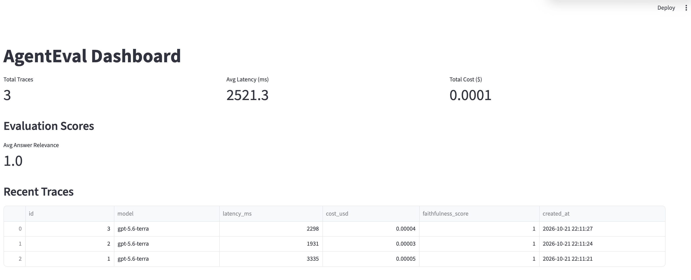
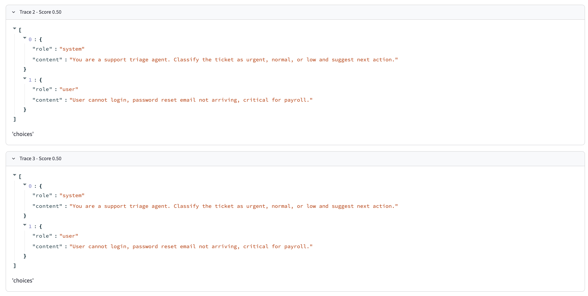

# AgentEval Proxy

Local OpenAI proxy that captures chat-completion calls, logs latency and estimated cost, and runs a simple answer-relevance score. Built as a working skeleton for instrumenting an agent without rewriting its code.

## Problem
Teams running LLM agents have little visibility into what the model actually returned, how long it took, or how much it cost. This proxy sits in front of the OpenAI endpoint and records every non-streaming call.

## What it does
- Forwards requests to the configured upstream (defaults to OpenAI) and logs the full trace.
- Stores traces in Postgres.
- Background worker scores answer relevance with an LLM-as-judge (temperature 0).
- Streamlit dashboard shows volume, latency, cost, and low-score examples.
- Demo agent lists models and picks the newest gpt-4 or gpt-5 name it can see.

## Measured results (local smoke test)
- 3 traces captured in a single demo run
- Average latency 2521 ms
- Total estimated model cost $0.0001 (judge cost not included)
- Average answer-relevance score 1.0
- Tool-call evaluation is not implemented

## Screenshots

## Example trace
Request: classify support ticket "User cannot login, password reset email not arriving, critical for payroll"  
Response: Classification: Urgent. Next action: escalate to IT support.  
Logged: 2298 ms, ~18 tokens, ~$0.00004

## Known limitations
- Tool-call correctness is not evaluated.
- Streaming responses are not fully logged.
- Upstream is OpenAI by default; set UPSTREAM_BASE to change it.
- Cost estimate uses a fixed gpt-4o-mini rate and excludes judge calls.
- No authentication on the proxy. For local use only.

## Quick start
1. Copy `.env.example` to `.env` and add an OpenAI key with credits.
2. `docker compose up --build`
3. Point a client at `http://localhost:8000/v1`.
4. Dashboard at `http://localhost:8501`.
5. Generate sample traces: `docker compose --profile demo run --rm demo`.

MIT License.