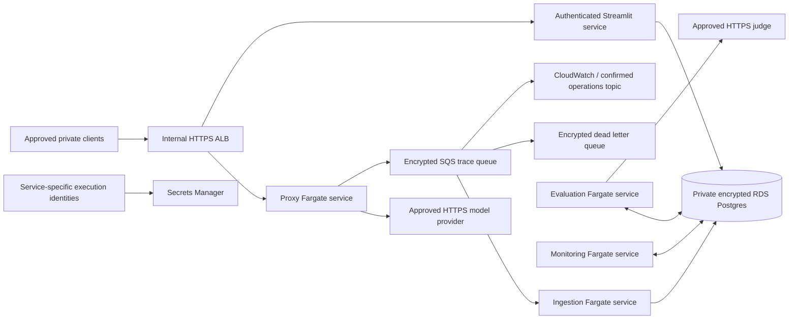

# Deployment preparation and approval gates

The repository's AWS files are a **locally validated infrastructure scaffold**, not a deployed or approved production environment. No AWS account, paid resources, public endpoints or production data were used. Passing `terraform validate` or mock-provider tests does not prove IAM, routing, runtime health, RDS connectivity, restore or billing behaviour in a real account.

See [platform choices and planning budget](PLATFORM_OPTIONS.md) before opening a cloud account. The intended initial scope is one organization per isolated private staging deployment with synthetic traffic. Multi-customer tenancy is not supported.

## Local stack first

```bash
python3.12 -m venv .venv
source .venv/bin/activate
python -m pip install -r requirements-lock.txt
# Explicitly insecure synthetic local mode, published ports bound to loopback:
docker compose -f docker-compose.yml -f docker-compose.offline.yml up --build -d --wait
docker compose -f docker-compose.yml -f docker-compose.offline.yml --profile demo run --rm demo
scripts/e2e_offline.sh
```

The stack separates proxy, durable ingestion, evaluation, monitoring and dashboard processes. Postgres stores traces/evaluation history. A retained SQLite WAL spool bridges local database outages; it is appropriate for one host/filesystem, not a network filesystem or distributed replica set. SQS is the cloud ingestion transport. Evaluations use committed PostgreSQL leases instead of adding a second queue that would need synchronization with stored traces.

Application images use a non-root UID, source ownership compatible with restrictive checkouts, read-only filesystems, dropped capabilities and bounded temporary space in local Compose. Dedicated database roles separate ingestion, evaluation, monitoring and read-only browsing from the migration owner. Local role passwords are intentionally synthetic. Secure mode fails closed without configured authentication; offline mode enables its bypass explicitly.

In a managed development environment, preserve its proxy and CA trust. Supply the CA to dependency-installing Docker steps through a BuildKit secret instead of disabling TLS. The onboarding helper under `/workspace/.cloud-setup/agenteval` does this outside the source tree when available.

## AWS layout



`infra/aws` includes internal HTTPS load balancing and private DNS, per-service IAM/secret access, immutable ECR repositories, private encrypted RDS with backups/deletion protection, SQS/DLQ with TLS and encryption, ECS task/service definitions, queue alarms and a tagged-project budget notification. Application tasks start with `desired_count=0` until migration is explicitly approved and completed. The provider restricts operations to the supplied account ID.

Existing prerequisites are deliberate inputs rather than silently created resources: an approved AWS account/region; separate state for staging and production; an existing VPC/private subnets in two zones; private client access; approved outbound routing/VPC endpoints; private Route 53 zone; ACM certificate covering the private hostname; service-specific secret resources; and a confirmed operations notification topic. Those prerequisites have **not** been provisioned or validated here. A private ALB is not reachable without private connectivity. Security groups constrain ports, while approved routing/egress controls must constrain external destinations.

## Safe local infrastructure checks

Terraform 1.10.5 and the committed provider lock are used for reproducible validation:

```bash
terraform fmt -check -recursive infra/aws
terraform -chdir=infra/aws init -backend=false -input=false
terraform -chdir=infra/aws validate
terraform -chdir=infra/aws test
```

The tests use a mock provider, cannot create AWS resources, and verify private/stopped defaults, encryption/backups, and rejection of open client networks/mutable image tags. Provider initialization downloads plugins with signature/checksum verification; it does not authorize an apply.

## Before any paid staging deployment

A reviewer must approve a concrete plan, cost calculation, access scope and teardown/retention procedure. Do not run `terraform apply`, image pushes, ECS task starts or public DNS changes merely because local checks pass.

1. Choose the account/region/platform and obtain the explicit deployment approval. Configure billing alerts first; budgets are not hard caps.
2. Bootstrap encrypted, access-controlled, versioned remote Terraform state with locking. The scaffold uses local state by default for validation; configure the approved backend before any real apply. Never rely on ephemeral CI local state for deployed resources. Keep independent staging/production state and preferably independent accounts.
3. Confirm private access, certificates, DNS, outbound provider allowlists, private database security groups and required service endpoints. Register confirmed notification recipients.
4. Build and scan the proxy, evaluator, dashboard and migration images. Push only after approval. Supply immutable ECR digest URIs in `image_digests`; never use `latest` for cloud deployment.
5. Supply distinct Secrets Manager JSON secrets for each service. Terraform receives ARNs only and does not store application credential values. Required keys are defined in `local.secret_keys`. Populate complete URL-encoded `DATABASE_URL` values for the least-privilege roles, with `sslmode=verify-full` and `/tmp/rds-ca.pem` trust. Use an authoritative **regional RDS CA bundle** that fits Secrets Manager size limits as `RDS_CA_PEM`. Verify certificate handling; never use `sslmode=disable`. Application secrets using customer-managed KMS keys need additional narrowly scoped decrypt grants; those are not provisioned by this scaffold.
6. Review a saved Terraform plan, including every charged resource. Keep `start_services=false` for the infrastructure step. Validate that the VPC, certificate, private zone and account inputs refer to the approved environment.
7. Fill the service database secrets with the resulting RDS endpoint. Run the dedicated migration task using its task-specific execution role, private subnets and task security group. It uses the RDS-managed administrative secret only for schema/role setup. The role bootstrap supports a non-superuser database owner with role-creation capability and refuses preexisting application roles with elevated attributes or inherited memberships. This capability was simulated on local Postgres; actual RDS administration remains a staging check. Check the task's stopped exit code and logs; a task ARN alone is not migration success.
8. Independently test runtime database grants and provider/proxy credential separation. Populate the operator reference/evaluator configuration through reviewed immutable files where needed; client metadata is not a trusted reference catalog.
9. Review the task definitions and run a single synthetic smoke task for each service. Verify non-root write access to the temporary volume, trusted RDS TLS, SQS encryption/redrive policy, callback connectivity, dashboard authentication and denied unauthenticated requests. Cloud runtime behaviour is untested until these checks actually run.
10. Only after migration and smoke checks succeed, approve `start_services=true`. Observe ECS circuit-breaker rollout, ALB readiness, ingestion/evaluation/monitor heartbeats, queue age and errors. Run synthetic load, interruption, restart, duplicate/replay and recovery checks.
11. Validate backup restore, deletion-policy replay suppression and incident access on a disposable copy. Record measured recovery objectives and approved operating ownership before a production readiness claim.

The current CI validates/tests/scans code and infrastructure; it does not automatically apply infrastructure or deploy production. A protected deployment environment, scoped OIDC release role and reviewed staged apply/migration/smoke/rollback automation remain prerequisites for a real cloud rollout.

## Rollback and recovery

ECS deployment circuit breakers are configured to roll back failed task deployments. Preserve the previous image digests and task definitions. Roll back a service by selecting the prior reviewed task definition, then repeat authenticated functional and queue tests. A schema migration is not automatically reversed by an image rollback; migrations require compatibility review and tested backup/restore. Never delete an RDS database or queue as a routine rollback.

RDS backups are seven days for staging and 35 days for the production parameter set, with final snapshot and deletion protection enabled. These settings are configuration, not a tested recovery result. Restore into a new isolated database, verify schemas/counts/privacy policy, test clients on synthetic traffic and perform an approved cutover. Reapply tombstones and deletion policy when restoring older backups. SQS/DLQ retention has an independent lifetime; investigate/redrive only after correcting the cause, never blindly replay deleted or sensitive events.

Never put credentials or personal information in query strings. Proxy Uvicorn access logs are disabled to avoid recording raw request targets. Provider, reverse-proxy and cloud edge logging require their own privacy controls; application trace redaction cannot sanitize another service's logs.
